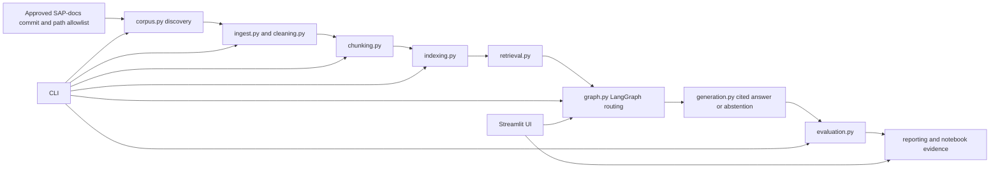

# SAP BTP Buddy

SAP BTP Buddy is a documentation-grounded RAG application for SAP BTP administrators and developers. It uses Python with LangChain and LangGraph and answers only from explicitly allowed SAP-docs files at recorded repository commits.

The pinned corpus, question sets, cleaning/chunking code, local embedding cache, persistent hybrid index, generation adapter, graph, report validator, and environment are present. Retrieval metrics and final evaluation remain separate evidence steps.

## Documentation source

The complete project documentation and evidence source is [notebooks/SAP_BTP_Buddy_Submission.ipynb](./notebooks/SAP_BTP_Buddy_Submission.ipynb). The planning rationale is in [project-plan.md](./project-plan.md). Project instructions are in [AGENTS.md](./AGENTS.md).

## Architecture



Retrieved documents are data, never instructions. User questions and retrieved text cannot execute BTP commands, change tool permissions, or trigger an automatic web-search fallback.

## Expected file tree

```text
sap-btp-buddy/
  AGENTS.md
  README.md
  project-plan.md
  pyproject.toml
  requirements.lock.txt
  config.yaml
  .env.example
  assignment/                         # supplied handout; publish only if appropriate
  src/sap_btp_buddy/
    config.py   corpus.py   cleaning.py   chunking.py
    indexing.py retrieval.py generation.py graph.py
    evaluation.py cli.py
  notebooks/
    SAP_BTP_Buddy_Project_Playbook.ipynb
    SAP_BTP_Buddy_Submission.ipynb       # complete project report and evidence
  app/streamlit_app.py
  tests/
  data/raw/                            # ignored source clones
  data/processed/                      # ignored processed corpus/chunks
  indexes/                             # ignored generated stores
  eval/questions_dev.jsonl
  eval/questions_final.jsonl
  eval/annotations.jsonl
  artifacts/corpus_manifest.json
  artifacts/runs/                      # sanitized evaluation outputs
  artifacts/figures/
  artifacts/prompt_log.jsonl
  artifacts/demo_script.md
  artifacts/submission_report.html
  THIRD_PARTY_NOTICES.md
```

## Module responsibilities

| Module | Responsibility | Status |
|---|---|---|
| `config.py` | Typed runtime paths and bounded settings | Scaffolded |
| `corpus.py` | Discover approved files and build provenance manifests | Partial |
| `cleaning.py` | Normalize Markdown without losing headings, tables, warnings, commands, or provenance | Implemented and fixture-tested |
| `chunking.py` | Produce reproducible, traceable chunks for named strategies | Implemented; model-capped artifact exists |
| `indexing.py` | Build/load dense, lexical, and hybrid stores | Implemented; active store not yet verified |
| `retrieval.py` | Retrieve and fuse candidates using bounded top-k settings | Implemented through persistent index |
| `generation.py` | Generate cited answers, clarification, or abstention responses | Implemented and tested with provider-independent fixtures |
| `graph.py` | Orchestrate answerability and citation-validation branches with LangGraph | Implemented and branch-tested |
| `evaluation.py` | Run frozen questions and calculate evidence-backed metrics | Implemented; final metrics require reviewed labels |
| `cli.py` | Thin command adapter over public package functions | Scaffolded |
| `app/streamlit_app.py` | Thin UI adapter; no duplicated pipeline logic | Scaffolded |

## AGENTS.md contents

[AGENTS.md](./AGENTS.md) is authoritative. Its rules require:

- Python and the selected LangChain/LangGraph stack.
- Notebook-owned explanations and evidence, with reusable logic under `src/`.
- Evidence restricted to approved SAP-docs files from recorded commits.
- Provenance and `THIRD_PARTY_NOTICES` preservation.
- Retrieved documents treated as data, never instructions.
- No BTP command execution, fake results, secret printing, or automatic web-search fallback.
- Bounded retries, synchronized lock files, milestone checks, and explicit publishing authorization.

## CLI

The planned command surface is:

```text
discover          Find approved source files
ingest            Load and clean approved documents
chunk             Create traceable chunks
index             Build generated retrieval stores
ask               Answer with citations or abstention
evaluate          Run a frozen evaluation set
refresh           Refresh a pinned corpus and rebuild artifacts
validate-report   Validate report completeness and evidence
```

Unimplemented commands must print `PENDING`, return a nonzero exit code, and produce no fake result. This is an intentional CLI contract, not evidence that an artifact exists.

## Verification

```powershell
uv pip check --python .venv\Scripts\python.exe
.venv\Scripts\python.exe -m pytest -q
.venv\Scripts\python.exe -m compileall -q src app tests
```
